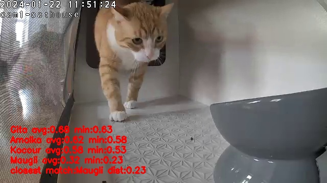

# CatAlarm

Recognises **which of your cats** is in front of a camera and reports it to **Home Assistant**,
so an automation can open or close the cover of a food bowl (our ginger Maugli needs a special
diet and is clever enough to steal the other cats' food).

v2 is a rewrite of the original OpenCV script: it runs as one Docker container, has a web UI,
and handles any number of cameras.

- **Multiple cameras**, each analysed separately, all sharing one gallery of reference pictures
- **Web UI**: live view with debug overlays, reference picture management (upload, crop, add from
  events), event timeline with relabelling, statistics, and a benchmark to compare models
- **Home Assistant**: one sensor per camera (`sensor.cat_ai_<camera>`) with confidence, distances
  and a snapshot URL
- **CPU only**: models run in ONNX Runtime, and PyTorch is not needed at runtime



## How it works

```
camera ─► reader thread (latest frame only, auto reconnect)
            │
            ▼
        night-vision check ─► motion gate (KNN background subtraction, per-camera mask)
                                   │ motion
                                   ▼
                shared inference worker (one model instance for all cameras)
                  YOLO11s: find the cat ─► crop ─► DINOv2 embedding ─► nearest references
                                   │
                                   ▼
        vote over the last N frames (e.g. 3 of 5) + hold time ─► state change
                                   │
            ┌──────────────────────┼─────────────────────┐
            ▼                      ▼                     ▼
      HA sensor              SQLite stats          web UI (SSE live updates)
```

The main improvement over v1 is **detect → crop → embed**. v1 embedded the whole frame, so the
background dominated the comparison. With the cat cropped first, distances separate the cats much
better, and frames where motion was caused by something other than a cat get rejected.

## Quick start

```bash
cp .env.example .env         # set RTSP_URL, HA_URL, HA_TOKEN
docker compose up -d
```

Open `http://<host>:8080`. On first start the old reference pictures from `templates/` are imported
into the gallery, and one camera is created from `RTSP_URL`. Add more cameras under **Settings**.

All state lives in `./data` (mounted at `/data`):

| Path | Content |
|---|---|
| `config.yaml` | cameras, thresholds, models, HA. Editable in the UI; `${VAR}` values are read from the environment |
| `gallery/<cat>/<day\|night>/*.jpg` | reference pictures (small crops) + `cats.yaml` + embedding cache |
| `catalarm.db` | SQLite: events, visits, performance samples (statistics only) |
| `snapshots/`, `captures/` | event pictures and saved frames |

Back up by copying the folder. The container runs as UID 1000, so `./data` must be writable by it.

### Build locally

```bash
docker build -t catalarm .
# include DINOv3 (gated on Hugging Face: accept the license, then use your token)
HF_TOKEN=hf_xxx docker build --secret id=hf_token,env=HF_TOKEN -t catalarm .
```

## Home Assistant

Each camera publishes `sensor.cat_ai_<camera>` through the REST API. The state is sent when it
changes and again every 60 s, because entities created this way vanish on an HA restart.

| State | Meaning |
|---|---|
| `maugli`, `gita`, … | cat identified (cat id) |
| `unconfirmed` | a cat is there but the match is too weak (attribute `cat` has the best guess) |
| `no_cat` | motion, but no known cat identified |
| `no_motion` | nothing happening |

Attributes: `cat`, `cat_id`, `confidence`, `margin`, `distances`, `night_mode`, `camera`,
`last_seen`, `snapshot_url` (set **Public URL** in Settings).

> Migrating from v1: the entity was `sensor.catAIdetect` with states like `Maugli` /
> `Unconfirmed:Maugli` / `noCat`. Update your automations to the new entity and lowercase states.

Example automation:

```yaml
automation:
  - alias: Close diet bowl when Maugli is not there
    trigger:
      - platform: state
        entity_id: sensor.cat_ai_cathouse
    action:
      - choose:
          - conditions: "{{ trigger.to_state.state == 'maugli' }}"
            sequence:
              - service: cover.open_cover
                target: { entity_id: cover.diet_bowl }
          - conditions: "{{ trigger.to_state.state in ['gita', 'amalka', 'kocour', 'unconfirmed'] }}"
            sequence:
              - service: cover.close_cover
                target: { entity_id: cover.diet_bowl }
              - service: notify.mobile_app_phone
                data:
                  message: "{{ state_attr('sensor.cat_ai_cathouse', 'cat') or 'Unknown cat' }} at the diet bowl"
                  data:
                    image: "{{ state_attr('sensor.cat_ai_cathouse', 'snapshot_url') }}"
```

## Improving recognition

1. **Events** shows every state change with a snapshot. When a cat was not recognised (or was
   recognised wrongly), relabel it and use **Add to gallery** to crop the snapshot into the
   references. The change applies immediately.
2. Keep about 5–20 pictures per cat for **day** and **night (IR)**. Tight crops of the cat work best.
3. **Cats → Similarity matrix** shows references that look too similar to another cat's.
4. **Benchmark** runs a leave-one-out test on your gallery for every installed model.
5. Tune the thresholds on the camera page. Lower **match distance** means stricter matching;
   more **votes** means slower but steadier identification.

### Model choice

Measured on the 31 original reference pictures (leave-one-out, laptop CPU):

| Embedder | Day top-1 | Day accepted | Night top-1 | ms / image |
|---|---|---|---|---|
| **DINOv2 ViT-S/14 reg** (default) | 94 % | 72 % | 100 % | ~57 |
| DINOv2 ViT-B/14 reg (v1 model) | 100 % | 94 % | 92 % | ~190 |
| MegaDescriptor-T (animal re-ID) | 78 % | 39 % | 54 % | ~55 |

*Accepted* means the match passed the threshold and would be reported. The self-supervised DINOv2
features beat a model trained specifically for animal re-identification on these cats. ViT-B is
more accurate in daylight but about 3× slower; switch to it in Settings if one or two cameras is
all you run. DINOv3 ViT-S/16 is supported when built with an HF token.

Detector: YOLO11s is the default because YOLO11n missed a dark tortoiseshell cat half-way through the
flap (`testImg/gita2.jpg`). YOLO11n is available as a faster option.

## Development

```bash
uv sync                       # runtime + dev dependencies
uv run pytest                 # tests use fake cameras and a model-free embedder
uv run ruff check . && uv run ruff format --check .

# real models (needs the export extra: torch, ultralytics, timm, transformers)
uv sync --extra export
uv run python -m catalarm.tools.export_models --out .models yolo11s dinov2_vits14_reg
uv run python -m catalarm.tools.selftest --models .models

# run locally, replaying the test pictures as a camera
CATALARM_DATA_DIR=.devdata CATALARM_MODELS_DIR=.models CATALARM_SEED_TEMPLATES=templates \
RTSP_URL="fake:testImg?fps=5" uv run catalarm
```

Camera URLs: `rtsp://…`, `http://…` (MJPEG), a video file path (loops), or `fake:<dir>?fps=N`.

Layout: `catalarm/` is the FastAPI backend. It serves a JSON API under `/api/v1` (OpenAPI docs at
`/docs`), MJPEG streams, and SSE at `/api/v1/live`. `frontend/` holds the static HTML + JS pages,
which talk to the backend only through the API. `legacy/` is the v1 code.

CI (`.github/workflows/ci.yml`) runs lint and tests, builds the image, runs the real-model self-test
and a container smoke test, and pushes `ghcr.io/skopy123/catalarm` for `master` and `v*` tags.
Add an `HF_TOKEN` repository secret to include DINOv3.

Note: the YOLO weights (Ultralytics) are AGPL-3.0 licensed, and DINOv3 has its own license. Check
both if you distribute the image beyond personal use.
